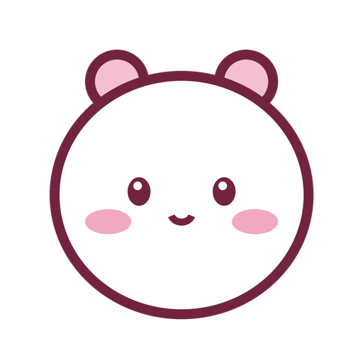

# Day clock

Маленькие розовые часы, которые показывают, сколько осталось до событий дня: обеда, конца работы, ужина, сна. Если время прошло, показывают, насколько оно просрочено (`+0:40`).

## Запуск

Ничего ставить не нужно — это одна HTML-страница.

- Двойной клик по `start.cmd` — откроется отдельное окошко Edge без вкладок. Его можно закрепить поверх окон через PowerToys (`Win+Ctrl+T`).
- Или просто откройте `index.html` в любом браузере.

## Настройка

Всё в [`config.js`](config.js): события (название, время, цвет) и цвета интерфейса. После правки обновите окно (`F5`).

Кнопки под часами выключают и включают события. Выбор запоминается.

## Отладка

`debug.cmd` (или `index.html?debug`) открывает часы с ползунком времени внизу — можно прокрутить весь день и посмотреть, как всё выглядит в любое время.

## Свой маскот

Положите картинку рядом под именем `mascot.local.png` — она заменит стандартную и не попадёт в git. Лучше всего квадратная, на прозрачном или белом фоне.
